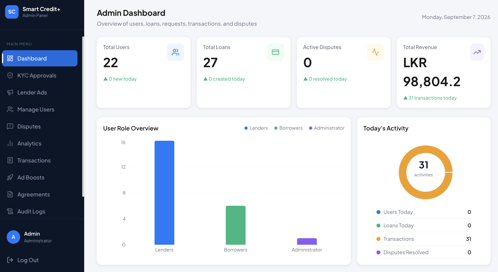
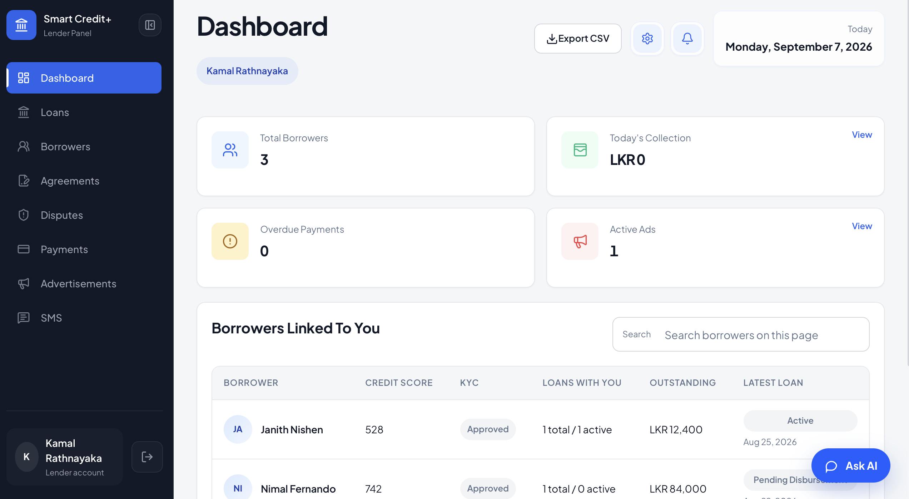
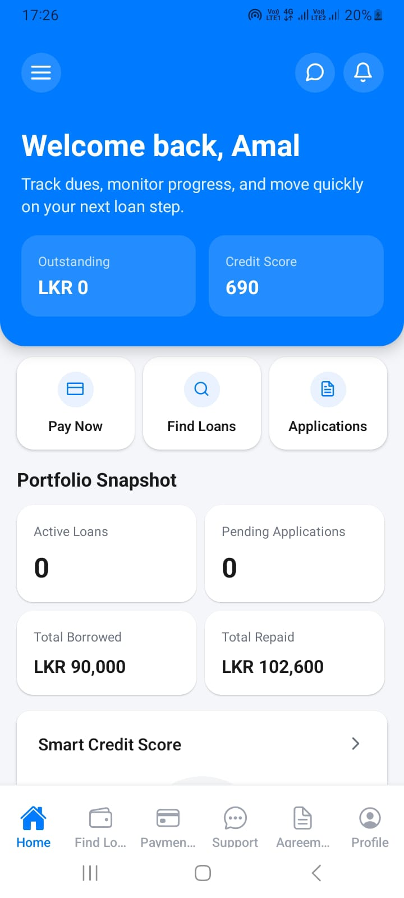
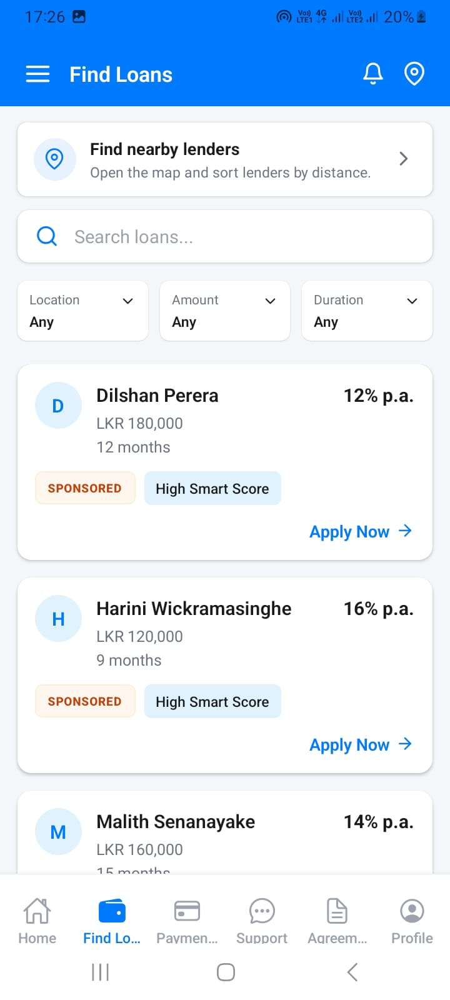
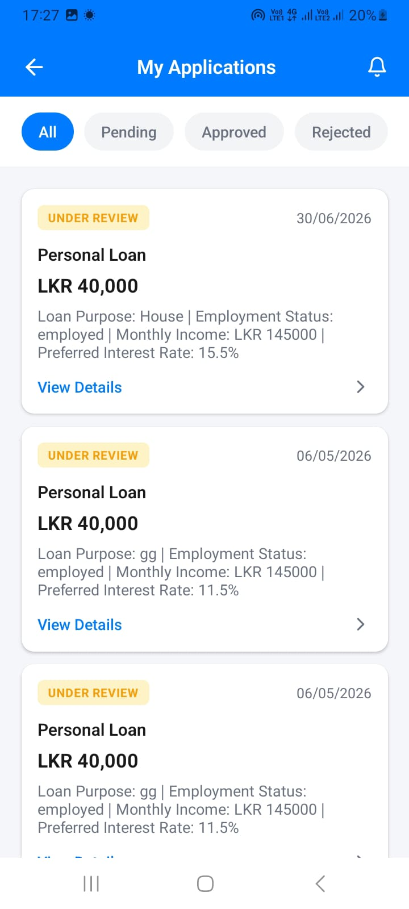
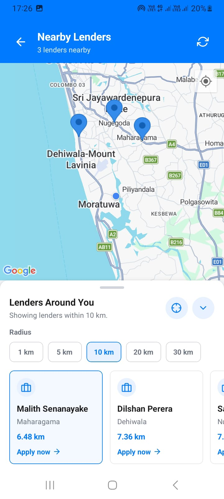
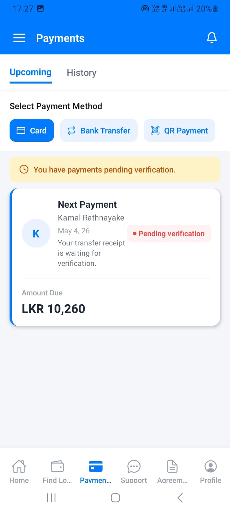

# Smart Credit+

**Smart Credit+** is a peer-to-peer lending platform designed to connect borrowers and lenders securely while simplifying loan requests, agreements, repayments, credit evaluation, and platform administration.

The system consists of:

- **Borrower mobile application** built with React Native / Expo
- **Lender web application**
- **Admin web application**
- **NestJS backend API**
- **Firebase-based backend services**

---

## Live Demo

**Demo:** https://smart-credit-api.vercel.app/

The hosted demo currently provides access to the **Admin** and **Lender** web interfaces.

> **Note:** The Borrower interface is mobile-only and is not included in the hosted web demo. The hosted demo may not remain permanently available, so local setup instructions are included below.

### Demo Login Credentials

| Role | Email | Password | Access |
| --- | --- | --- | --- |
| Admin | `admin@smartcredit.lk` | `SmartCredit@1234` | Web |
| Lender | `lender@smartcredit.lk` | `SmartCredit@123` | Web |
| Borrower | `amal@gmail.com` | `SmartCredit@123` | Mobile only |

> These accounts are intended for development/demo use only. Never commit production passwords, API keys, Firebase credentials, private keys, or other secrets to the repository.

---

## Screenshots

### Admin Dashboard



### Lender Web App



### Borrower Mobile App

<p>
 
  
   
  
  
  
</p>

---

## Project Overview

Smart Credit+ provides a digital environment for short-term and micro-loan interactions between borrowers and lenders. It is designed to improve transparency and reduce manual work through features such as credit evaluation, digital loan agreements, repayment tracking, QR-based workflows, notifications, and administrative monitoring.

The platform uses role-based access for **Borrowers**, **Lenders**, and **Administrators**.

---

## Key Features

### Borrower — Mobile Application

- Register and access the system as a borrower
- Complete KYC-related onboarding
- Create and submit loan requests
- View loan information and repayment progress
- View credit-related information
- Sign digital loan agreements
- Perform repayment-related actions
- Use QR-based loan/repayment functionality
- Access notifications and in-app guidance

### Lender — Web Application

- View a lender dashboard
- View and manage linked borrowers
- Review borrower information and credit scores
- Manage loans
- Review agreements
- Monitor payments and overdue payments
- Manage advertisements
- Handle disputes
- Access SMS-related functionality
- View lender activity and operational information

### Admin — Web Application

- View overall platform statistics
- Review KYC approvals
- Manage users
- Manage lender advertisements
- Monitor loans and transactions
- Handle disputes
- View analytics
- Manage agreements
- Review audit logs
- Monitor platform activity and revenue-related information

---

## Technology Stack

| Layer | Technology |
| --- | --- |
| Borrower/Lender Mobile App | React Native, Expo |
| Web Applications | React, TypeScript, Vite |
| Backend API | NestJS, TypeScript |
| Database / Backend Services | Firebase |
| Authentication / Authorization | JWT / Passport-based backend support |
| Real-time Communication | Socket.IO |
| Mobile Networking | Axios |
| QR / Camera Features | Expo Camera, Barcode Scanner, QR libraries |
| Maps / Location | Expo Location, React Native Maps |
| Testing | Jest |
| Version Control | Git / GitHub |
| Deployment | Vercel |

### Notable Versions

- Expo `~54.0.0`
- React Native `0.81.5`
- React `19.x`
- NestJS `11.x`
- Vite `8.x`
- TypeScript `5.x / 6.x` depending on the application package

---

## System Roles

```text
Smart Credit+
│
├── Borrower
│   └── React Native / Expo Mobile Application
│
├── Lender
│   └── Web Application
│
├── Admin
│   └── Web Application
│
└── Backend
    └── NestJS API + Firebase
```

---

## Repository

https://github.com/NishenAMJ/Smart_Credit_API

---

## Run Locally

### Prerequisites

Install the following before running the project locally:

- Git
- Node.js
- npm
- Expo Go or an Android/iOS development environment for the mobile application
- Access to the Firebase configuration used by the project

> The exact Node.js version is not specified in the provided package files. Use a Node.js version compatible with the installed dependencies.

### 1. Clone the Repository

```bash
git clone https://github.com/NishenAMJ/Smart_Credit_API.git
cd Smart_Credit_API
```

---

### 2. Backend Setup

From the `Backend` directory:

```bash
cd Backend
npm install
npm run start:dev
```

The development command starts the NestJS server in watch mode.

Other useful backend commands:

```bash
# Build
npm run build

# Start normally
npm start

# Start production build
npm run start:prod

# Run tests
npm test

# Run end-to-end tests
npm run test:e2e
```

---

### 3. Admin / Lender Web Application

From the directory containing the web frontend package:

```bash
npm install
npm --prefix web install
npm run dev
```

The root frontend development script delegates to the `web` application.

For a production build:

```bash
npm run build
```

To preview the production build locally:

```bash
npm run preview
```

---

### 4. Borrower Mobile Application

The Borrower interface is a **React Native / Expo mobile application**.

From the directory containing the mobile application's `package.json`:

```bash
npm install
npm start
```

Equivalent Expo command:

```bash
npx expo start
```

You can also launch a platform directly:

```bash
# Android
npm run android

# iOS
npm run ios
```

After Expo starts, open the project using **Expo Go** on a compatible device or use an Android/iOS emulator.

> Although the Expo package includes a web script, the Smart Credit+ Borrower experience is intended to be used as a mobile application.

---

## Environment Configuration

The backend, web applications, and mobile application may require environment-specific configuration such as Firebase credentials and API endpoints.

Before running locally:

1. Configure the environment files used by each application.
2. Set the correct backend/API URL.
3. Configure the Firebase project credentials required by the application.
4. Keep all secrets outside version control.

If an `.env.example` file is available in the repository, copy it to the appropriate `.env` file and provide your own values.

```bash
# Example only
cp .env.example .env
```

> Do not publish real credentials, service-account keys, JWT secrets, or private Firebase configuration intended to remain secret.

---

## Main Project Capabilities

Smart Credit+ was designed around the following major workflows:

- Secure role-based access
- Borrower and lender interaction
- KYC verification
- Loan request and approval workflows
- Credit-rating-based lending support
- Dynamic interest-rate suggestions
- Digital loan agreements
- Digital signatures
- QR-assisted repayment workflows
- Repayment and transaction tracking
- Notifications and user guidance
- Dispute management
- Administrative monitoring and analytics

---

## Team Members

| Index No. | Name |
| --- | --- |
| 234146N | A.M.J. Nishen — Leader |
| 234128L | H.L. Manujaya |
| 234120F | S.N.P. Liyanage |
| 234177J | H.P.K. Rasadika |
| 234126E | K.A.D. Mahinsa |

---

## Academic Project

Smart Credit+ was developed as a university software project. The repository is intended to demonstrate the design and implementation of a multi-role peer-to-peer lending platform.

---

## Security Notice

The credentials shown in this README are **demo accounts only**.

For any production deployment:

- Remove or rotate demo credentials
- Keep Firebase/service-account credentials private
- Keep JWT and API secrets outside the repository
- Use environment variables or a secure secret-management service
- Apply appropriate authorization and access-control rules

---

## License

The backend package is currently marked as `UNLICENSED`.

Unless a separate license is added to this repository, the project should not be assumed to be open-source for unrestricted reuse.
